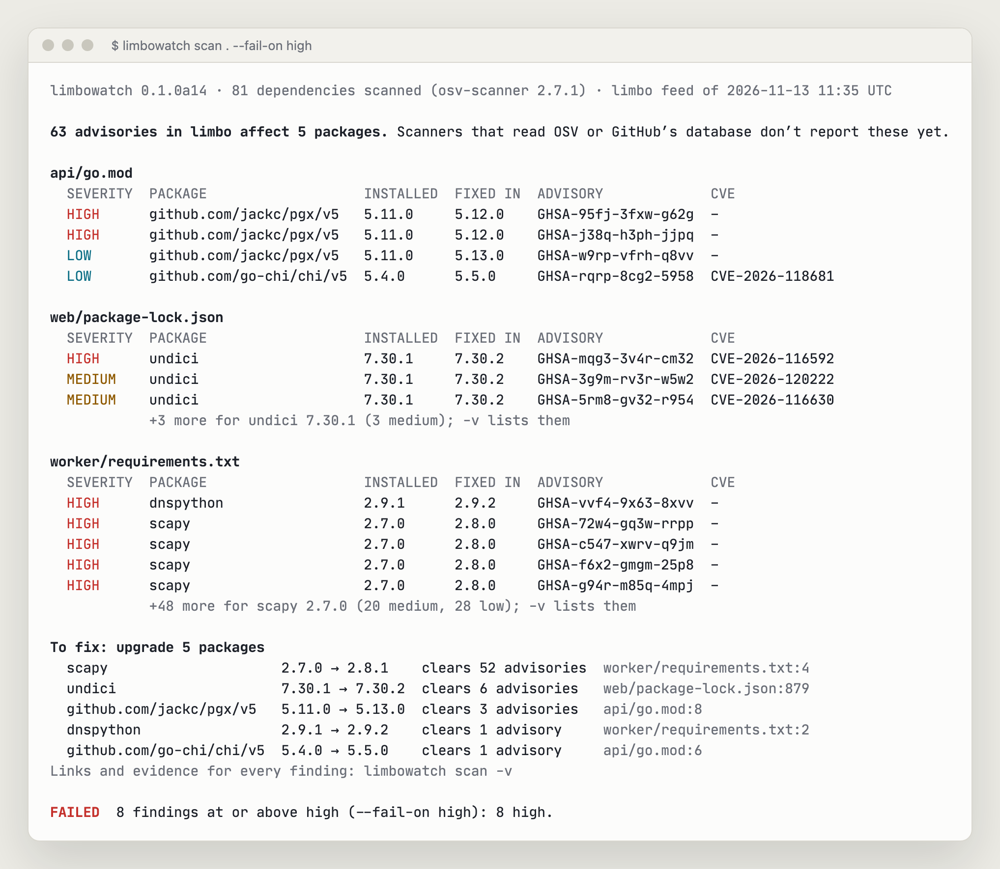
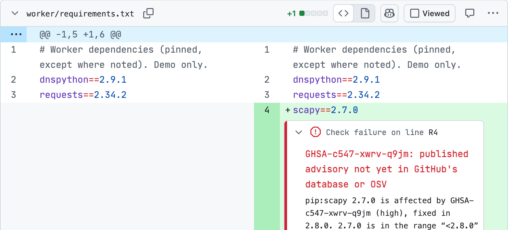
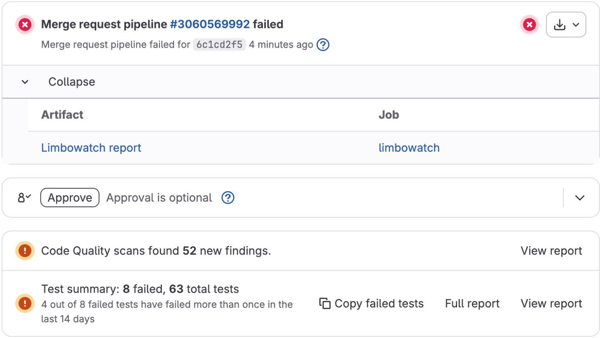

<p align="center">
  <picture>
    <source media="(prefers-color-scheme: dark)" srcset="brand/assets/wordmark-transparent-light-text.png">
    
  </picture>
</p>

# Limbowatch

**Published. Not reviewed. Not scanned. In limbo.**

[limbo.watch](https://limbo.watch) · [GitHub Marketplace](https://github.com/marketplace/actions/limbowatch) · [GitLab CI/CD Catalog](https://gitlab.com/explore/catalog/limbowatch/limbowatch-component) · [PyPI](https://pypi.org/project/limbowatch-cli/) · [Check a package](https://limbo.watch/check/)

Limbowatch measures the gap between a maintainer publishing a security advisory and your scanner being able to see it, and closes it in your CI.

When a maintainer publishes a security advisory in their GitHub repository, Dependabot, npm audit, OSV-Scanner and most other dependency scanners stay silent until GitHub reviews that advisory into its global Advisory Database. Until then, the advisory is **in limbo**: public, usually already fixed upstream, and invisible to the tools teams rely on.

## Scan your project

`limbowatch scan` checks your lockfiles against every advisory in limbo and shows what it finds where your team already looks: GitLab merge requests (Code Quality), GitHub pull requests (code scanning), and issues in GitLab, Gitea or Forgejo.

```yaml
# GitLab CI
include:
  - component: $CI_SERVER_FQDN/limbowatch/limbowatch-component/limbowatch@0.1.0-alpha.5
    inputs:
      fail_on: high
```

```yaml
# GitHub, Gitea or Forgejo Actions
- uses: actions/checkout@v4
- uses: limbowatch/limbowatch-action@v0.1.0a5
  with:
    fail-on: high
    sarif: limbowatch.sarif
```

What it finds, measured 2026-11-07 and 11-08 against the live feed:

- **1,080 confirmed findings in 13 popular open-source projects that Dependabot didn't alert on.** On the same dependency files GitHub's Dependabot raised 2,020 alerts, none for any of them, though every affected package was in GitHub's own dependency graph: the advisories hadn't been reviewed yet. 277 advisories; 262 findings rated critical or high; only 95 with a CVE. Each was rechecked with the ecosystem's own version library. [The comparison](research/2026-11-dependabot-compare/), [FINDINGS F-112](docs/FINDINGS.md#f-112).
- **16 vs 0 on a demo app** with real npm, Go, pip and Bundler lockfiles: Limbowatch found 16 advisories in limbo; OSV-Scanner and GitHub's Dependabot alerts reported none of them. See the [demo pull request](https://github.com/limbowatch/demo-app/pull/1): 51 new alerts, inline on the line that adds the package. [Evidence: all 16 rechecked against GitHub and OSV](research/2026-11-demo-evidence/), 1.6 to 23.5 days in limbo.

<picture><source media="(prefers-color-scheme: dark)" srcset="docs/screenshots/terminal.png"></picture>

In a GitHub pull request (code scanning alerts inline) and a GitLab merge request (Code Quality, test summary, report link):

<picture><source media="(prefers-color-scheme: dark)" srcset="docs/screenshots/github-pr-inline.png"></picture>
<picture><source media="(prefers-color-scheme: dark)" srcset="docs/screenshots/gitlab-mr-widgets.png"></picture>

Guide: [docs/WATCHER.md](docs/WATCHER.md) · [limbo.watch/scan](https://limbo.watch/scan/). The GitHub Action is [limbowatch/limbowatch-action](https://github.com/limbowatch/limbowatch-action), listed in [GitHub Marketplace](https://github.com/marketplace/actions/limbowatch); the GitLab component is in the [GitLab CI/CD Catalog](https://gitlab.com/explore/catalog/limbowatch/limbowatch-component). The current release is an alpha, 0.1.0a5: `pipx install limbowatch-cli==0.1.0a5`. Options and formats may still change before 0.1.0.

## Why this exists

In June 2026 I reported a critical vulnerability in [NationalSecurityAgency/skills-service](https://github.com/NationalSecurityAgency/skills-service/security/advisories/GHSA-hqfg-c8wf-w2g8). The advisory was published on 16 June, but its CVE stayed reserved for 85 days, and four months later scanners that read GitHub's database, OSV or NVD still can't match it. I wanted to know how many other advisories are stuck the same way. The answer is thousands. [The full story](https://limbo.watch/why/).

## The October 2026 report

📊 **[State of the Gap (October 2026)](research/2026-10-state-of-the-gap/README.md)**. Main findings (snapshot 2026-10-22, 15 projects on GitHub, GitLab, Codeberg, Tor, GNOME, Framagit and SourceHut):

- **About 1 in 6 upstream advisories is in limbo.** That's 415 of 2,517 unique advisories (16.5%) in the upstream repos of fifteen popular projects, each verified automatically against primary sources.
- **The median wait for GitHub review is 23 days.** 94% of advisories wait longer than the 72 hours GitHub's documentation gives, and 44% longer than 30 days. GitHub has said it has missed its own goals since mid-April 2026.
- **13 of 14 readable projects ship affected versions that a scanner reports as clean.** Counted per project, that's 105 package-versions (92 distinct ones) that OSV-Scanner reports as having no known vulnerabilities, including in GitLab, Forgejo, Gitea and Kubernetes. Hosting your code off GitHub doesn't help: your dependencies' advisories are still stuck there.
- **CVE data is out of sync too.** 27 CVE IDs are reserved but public, the oldest for 119 days. 23 advisories have a VulnCheck- or Tenable-assigned CVE they don't cite. Many CVEs aren't enriched in NVD.

The methods, open dataset (CC BY 4.0) and scripts to reproduce it are in the [report folder](research/2026-10-state-of-the-gap/).

## Use it

- **[limbo.watch](https://limbo.watch):** the live tracker. It lists every advisory in limbo across more than 60,000 watched repositories, including the source repos of the 10,000 most-used packages in each ecosystem. Updated daily.
- **[Check a package](https://limbo.watch/check/):** type a package from npm, PyPI, crates.io or Maven, and your browser checks it and its whole dependency tree (resolved by [deps.dev](https://deps.dev)) against the advisories in limbo.
- **[The limbo feed](https://limbo.watch/feed/):** the same advisories as OSV-schema records. The released OSV-Scanner can already scan against it.
- **The watcher**, `limbowatch scan`: checks your project's dependencies against advisories in limbo, in CI or locally. One scan writes any of ten formats (table, JSON, Markdown, HTML, SARIF, GitLab Code Quality, JUnit, CSV, CycloneDX, GitHub annotations), and it keeps one issue per finding up to date in GitLab or Gitea/Forgejo. `pip install limbowatch-cli`. See the [guide](docs/WATCHER.md), the [GitLab CI/CD component](https://gitlab.com/explore/catalog/limbowatch/limbowatch-component) and the [GitHub Action](https://github.com/marketplace/actions/limbowatch).

## Terms

| Term | Meaning |
|---|---|
| **In limbo** | A published repository advisory that isn't yet in GitHub's reviewed Advisory Database or in OSV |
| `LIMBO_ADVISORY` | In limbo, with no public CVE |
| `LIMBO_ADVISORY` + `RBP` | In limbo; its CVE ID is *reserved but public* (the CVE Program's term) |
| `LIMBO_CVE` | In limbo, but its CVE record is published |
| `NO_CVE` | Reviewed by GitHub, but no CVE, so tools keyed on CVE IDs miss it |

## Roadmap

| Phase | Status |
|---|---|
| 1. "State of the Gap" report | published 2026-11-10 |
| 2. Live Limbo Tracker and an open **limbo feed** (OSV schema) | **live** at [limbo.watch](https://limbo.watch) |
| 3. Contributions to existing tools ([blindspot](https://github.com/munimtechnologies/advisory-import-census), OSV-Scanner) | prepared, not sent ([drafts](docs/outreach/)) |
| 4. Limbowatch watcher for GitLab, GitHub, Gitea and Forgejo: CI component and action, issues that update as advisories move through review | **released** as 0.1.0a1, an alpha; current 0.1.0a5 ([PyPI](https://pypi.org/project/limbowatch-cli/), [GitLab CI/CD Catalog](https://gitlab.com/explore/catalog/limbowatch/limbowatch-component), [GitHub Marketplace](https://github.com/marketplace/actions/limbowatch)) |
| 5. Org-wide watch, more ecosystems (Maven/Gradle first) | planned |
| 6. C/C++ and vendored code | planned |

Limbowatch builds only what existing tools don't do. See [the plan](docs/PHASE0_PLAN.md) and [research findings](docs/FINDINGS.md).

## Prior work

This builds on work by [Safeguard](https://safeguard.sh/resources/blog/github-repository-advisories-missing-from-advisory-database-2026-data), [Munim, Inc. (advisory-import-census / blindspot)](https://github.com/munimtechnologies/advisory-import-census) and [RogoLabs](https://rbptracker.org) (Jerry Gamblin).

## License

- **Code:** [Apache-2.0](LICENSE).
- **Research data:** [CC BY 4.0](research/2026-10-state-of-the-gap/data/LICENSE).
- **Advisory data** comes from the [GitHub Advisory Database](https://github.com/advisories) (CC BY 4.0) and [OSV](https://osv.dev).
