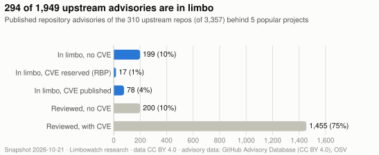
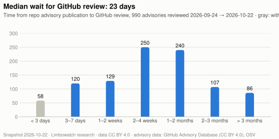
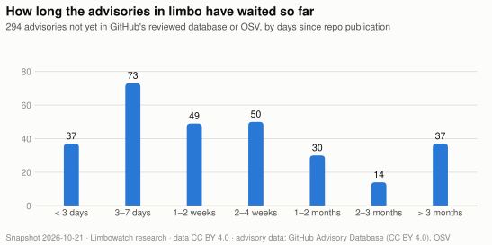
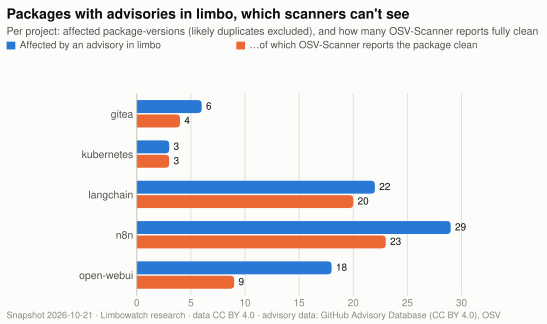
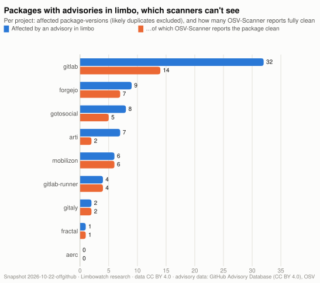

# State of the Gap: security advisories in limbo (October 2026)

**DRAFT for review, not published.** Snapshot taken 2026-10-22. Limbowatch research.

> When a maintainer publishes a security advisory on GitHub, most dependency scanners can't see it until GitHub reviews it into the global Advisory Database. We measured that waiting period, which we call **limbo**, across the dependencies of fifteen popular open-source projects: five hosted on GitHub and ten hosted elsewhere (GitLab, Codeberg, Tor, GNOME, Framagit, SourceHut).

## Key numbers

- **About 1 in 6 upstream advisories is in limbo.** Across the upstream repositories of all fifteen projects, **415 of 2,517** unique published advisories (**16.5%**) are in neither GitHub's reviewed database nor OSV. That's 14.3% behind the GitHub-hosted projects and 17.1% behind the projects hosted elsewhere.
- **The median wait for review is 23 days.** For 990 advisories GitHub reviewed between 2026-09-24 and 2026-10-22, **94% waited longer than 72 hours and 44% longer than 30 days.**
- **13 of the 14 projects we could read ship affected versions that a scanner reports as clean.** Counted per project, that's **105 package-versions** (92 distinct ones) affected by advisories in limbo that OSV-Scanner reports with no known vulnerability at all. It includes GitLab (14), Forgejo (7), Gitea (4) and Kubernetes (3).
- **Three days later, little had moved.** By 2026-10-25, GitHub had reviewed 34 of the 415 (8%), all in one batch on Oct 23. 381 were still in limbo, and 249 of those still had no CVE of any kind.
- **CVE data is out of sync too.** 27 advisories in limbo cite a CVE ID that's still *reserved*, up to 119 days later. Another 23 have a CVE, almost all assigned by **VulnCheck**, that the advisory itself doesn't cite. For those, CVE-based tools see them before GitHub-based scanners do.

## What "limbo" means

```
 maintainer publishes          CVE record            GitHub review →          OSV imports it;
 a repository advisory         published             global Advisory DB       scanners update
        │                          │                        │                       │
────────●──────────────────────────●────────────────────────●───────────────────────●──────▶
        │◀────────────── in limbo: invisible to Dependabot, npm audit, ────────────▶│
                         pip-audit, OSV-Scanner and other scanners that
                         read the global databases
```

GitHub lets maintainers publish a security advisory directly in their repository. Dependabot, OSV and most scanners read GitHub's *global* Advisory Database, and an advisory only gets there after GitHub reviews it. GitHub says that "since mid-April… we have not consistently met our internal goals for publication" and that repository advisories rose "to more than 5,000/week" ([GitHub blog, June 2026](https://github.blog/security/supply-chain-security/inside-the-advisory-database-and-what-happens-when-vulnerability-volume-breaks-records/)). The advisory is public and the fix is usually released, but scanners stay silent.

These events don't happen in a fixed order. Some advisories get a CVE first and some never get one. Some reserve a CVE ID that stays unpublished. Some get a CVE from another CNA that the advisory never mentions, and some are reviewed under a different GHSA ID. We record each fact separately.

## What the CVE states mean

A **CVE** is a public ID for a vulnerability, like `CVE-2026-110858`. A repository owner can't create one alone: CVE IDs are issued by **CNAs** (CVE Numbering Authorities), organizations allowed to assign them, such as GitHub, VulnCheck, Red Hat or MITRE. A maintainer who publishes an advisory on GitHub can click *Request CVE*, and GitHub (acting as a CNA) reviews the request, reserves an ID and later publishes the CVE record. A maintainer can also get an ID elsewhere and type it into the advisory.

Many security tools track vulnerabilities by CVE ID. NVD-based scanners, vulnerability-management dashboards, compliance reports and patch SLAs often ignore anything without one. So for each advisory in limbo, we check the CVE side separately:

| State | What it means | Who can see it |
|---|---|---|
| **No CVE anywhere** | The advisory has no CVE ID, and no record in the entire CVE List refers to it. Either the maintainer never requested one, or a request is still pending (pending requests aren't public, so we can't tell which). | Only someone reading the repository's advisory page. Neither GitHub-based nor CVE-based tools know it exists. |
| **CVE reserved (RBP)** | The advisory shows a CVE ID, but the CVE record behind it hasn't been published. The ID exists; its content doesn't. The CVE Program calls this *Reserved But Public* and expects publication within 72 hours. | Effectively no tool: looking up the ID returns nothing. |
| **CVE published, cited by the advisory** | The usual case: the advisory names a CVE whose record is published. | CVE- and NVD-based tools can look it up (if NVD has enriched it, Finding 6). GitHub/OSV-based scanners still can't, until GitHub reviews the advisory. |
| **CVE published by another CNA, not cited** | Someone other than the maintainer, almost always **VulnCheck**, published a CVE that refers to this advisory, but the advisory itself doesn't mention it. | CVE-based tools *can* see it, while the advisory's own page and GitHub-based scanners don't connect the two. The usual gap, reversed. |

Two examples from the data:

- **[GitPython GHSA-f9j4-qggq-h239](https://github.com/gitpython-developers/GitPython/security/advisories/GHSA-f9j4-qggq-h239)** (critical, command injection). Published by the maintainers on GitHub without a CVE. On 2026-10-14, VulnCheck published [CVE-2026-110858](https://www.cve.org/CVERecord?id=CVE-2026-110858) referring to it. As of 2026-10-25 the advisory still doesn't cite that CVE, and GitHub still hasn't reviewed it. open-webui ships an affected version, and OSV-Scanner doesn't report this advisory for it.
- **[regexp2 GHSA-wq9v-j77v-qr26](https://github.com/dlclark/regexp2/security/advisories/GHSA-wq9v-j77v-qr26)** (high, memory exhaustion). Published 2026-07-11 citing CVE-2026-77299. More than 100 days later, that CVE is still `RESERVED`, so looking it up returns no record. Forgejo ships an affected version.

## Finding 1: about one in six upstream advisories is in limbo

<picture>
  <source media="(prefers-color-scheme: dark)" srcset="charts/fig1-advisory-states-dark.svg">
  
</picture>

| State | GitHub-hosted projects | | Projects hosted elsewhere | |
|---|---:|---:|---:|---:|
| In limbo, no CVE anywhere | 178 | 9.5% | 158 | 12.5% |
| In limbo, CVE reserved (RBP) | 15 | 0.8% | 16 | 1.3% |
| In limbo, CVE published, cited by the advisory | 53 | 2.8% | 38 | 3.0% |
| In limbo, CVE published by another CNA, not cited | 22 | 1.2% | 5 | 0.4% |
| Reviewed, no CVE | 205 | 10.9% | 111 | 8.8% |
| Reviewed, with CVE | 1,403 | 74.8% | 940 | 74.1% |
| **Advisories in upstream repos** | **1,876** | | **1,268** | |

The two columns overlap: 627 advisories appear in both, because npm and Go libraries are everywhere. Unique across both: **2,517 advisories, 415 in limbo (16.5%)**. Automated duplicate checks move the shares only slightly, to 13.9–14.0% and 15.9–16.1%.

- **Confirmed directly.** Every advisory missing from OSV also returned *not found* from GitHub's global advisory API. In a random sample of 200 advisories present in OSV, all 200 were reviewed.
- **Mostly without any CVE.** Two thirds or more (178 of 268, and 158 of 217) have no CVE anywhere, so tools keyed on CVE IDs can't track them either. See [What the CVE states mean](#what-the-cve-states-mean).
- **Mostly serious.** By the maintainers' own rating, GitHub-hosted set: 11 critical, 104 high, 123 medium, 30 low.
- **Ecosystems.** npm, pip and Go dominate. RubyGems appears only through the off-GitHub projects, and most Rust advisories (61 of 66) do too.

## Finding 2: the median wait for review is 23 days

<picture>
  <source media="(prefers-color-scheme: dark)" srcset="charts/fig2-review-lag-dark.svg">
  
</picture>

We took the 1,000 most recently reviewed advisories, reviewed between 2026-09-24 and 2026-10-22. 990 of them began as repository advisories. For each, we compared when the maintainer published it with when GitHub reviewed it.

| Wait until review | Advisories |
|---|---:|
| < 3 days (within GitHub's 72-hour target) | 58 |
| 3–7 days | 120 |
| 1–2 weeks | 129 |
| 2–4 weeks | 250 |
| 1–2 months | 240 |
| 2–3 months | 107 |
| > 3 months | 86 |

Median **23.0 days**, p25 11.6, p75 50.4, p90 86.5.

The CVE usually isn't the bottleneck: 92% of the CVEs (793 of 858) were published *before* the review, a median of one day earlier. The CVE itself took a median of 17 days after the repository advisory. 120 of the 1,000 reviewed advisories (12%) have no CVE at all.

Review also arrives in bursts. Of the 294 advisories in limbo in a first measurement on 2026-10-21, 37 were reviewed the next day, all between 15:46 and 17:01 UTC on 2026-10-22 (Pillow ×11, Electron ×6, and others).

## Finding 3: most advisories in limbo are recent, but some are old

<picture>
  <source media="(prefers-color-scheme: dark)" srcset="charts/fig3-limbo-age-dark.svg">
  
</picture>

| Waiting so far | GitHub-hosted set | Off-GitHub set |
|---|---:|---:|
| < 3 days | 46 | 23 |
| 3–7 days | 52 | 11 |
| 1–2 weeks | 40 | 26 |
| 2–4 weeks | 54 | 37 |
| 1–2 months | 26 | 62 |
| 2–3 months | 15 | 18 |
| > 3 months | 35 | 40 |
| **Median** | **13 days** | **37 days** |

The off-GitHub set waits longer: its dependencies (Go, Rust, Ruby) include more advisories that have sat for months. These are snapshots of advisories still waiting, so the ages keep growing and aren't directly comparable to Finding 2. The oldest has waited over seven years.

## Finding 4: real projects ship affected versions that a scanner reports as clean

<picture>
  <source media="(prefers-color-scheme: dark)" srcset="charts/fig4-projects-dark.svg">
  
</picture>

We read every lockfile of each project with OSV-Scanner v2.7.0. We then matched each package to its upstream repository and checked that repository's advisories against the exact version in use. A version only counts as affected if it's inside the maintainer's range **and** not at or past the advisory's fixed version (see [Data quality](#data-quality-what-we-had-to-correct-for)).

| Project (commit) | Package entries | Affected package-versions | …reported clean by OSV-Scanner | Advisories in limbo affecting it | of which high/critical |
|---|---:|---:|---:|---:|---:|
| [n8n-io/n8n](https://github.com/n8n-io/n8n) (`7d2e358`) | 3,988 | 33 | 26 | 50 | 24 |
| [langchain-ai/langchain](https://github.com/langchain-ai/langchain) (`f4e6cde`) | 2,513 | 23 | 21 | 53 | 18 |
| [open-webui/open-webui](https://github.com/open-webui/open-webui) (`91ea4e3`) | 2,083 | 18 | 10 | 58 | 18 |
| [go-gitea/gitea](https://github.com/go-gitea/gitea) (`facc0f2`) | 1,197 | 6 | 4 | 16 | 9 |
| [kubernetes/kubernetes](https://github.com/kubernetes/kubernetes) (`8f5bbad`) | 2,042 | 3 | 3 | 4 | 3 |

"Reported clean" means OSV-Scanner reports *no* vulnerability at all for that package-version. A package can also have other, known vulnerabilities and still miss the advisory in limbo. Advisories already reviewed under another GHSA ID with the same CVE are excluded.

**Examples.** Each was automatically verified on 2026-10-22 at 17:59 UTC (`verification.csv`):
- the repo advisory is still published;
- it's absent from GitHub's global database and from OSV;
- OSV-Scanner doesn't report it for that version;
- the version is inside the range and below the fixed version;
- it isn't a duplicate.

| Package@version (ecosystem) | Used by | Advisory | Severity | CVE status | Days in limbo | Fixed in |
|---|---|---|---|---|---:|---|
| `github.com/go-jose/go-jose/v4@4.1.5` (Go) | kubernetes | [GHSA-mgcc-cww5-fp2q](https://github.com/go-jose/go-jose/security/advisories/GHSA-mgcc-cww5-fp2q) | high | no CVE | 8 | 4.1.6 |
| `github.com/anishathalye/porcupine@1.3.0` (Go) | kubernetes | [GHSA-v76q-fhj2-wh42](https://github.com/anishathalye/porcupine/security/advisories/GHSA-v76q-fhj2-wh42) | high | no CVE | 14 | 1.3.1 |
| `@sinclair/typebox@0.27.10` (npm) | gitea, open-webui | [GHSA-976x-prgx-qv35](https://github.com/sinclairzx81/sinclair-typebox/security/advisories/GHSA-976x-prgx-qv35) | high | reserved (RBP), CVE-2026-77356 | 62 | 0.27.12 |
| `seroval@1.5.4` (npm) | gitea | [GHSA-9355-h2pj-8fqj](https://github.com/lxsmnsyc/seroval/security/advisories/GHSA-9355-h2pj-8fqj) | high | no CVE | 24 | 1.6.4 |
| `@redocly/cli@1.34.21` (npm) | n8n | [GHSA-xw2f-5386-m542](https://github.com/Redocly/redocly-cli/security/advisories/GHSA-xw2f-5386-m542) | high | published, CVE-2026-63325 | 87 | 2.33.0 |
| `mssql@12.7.0` (npm) | n8n | [GHSA-rc93-2r6p-hc2q](https://github.com/tediousjs/node-mssql/security/advisories/GHSA-rc93-2r6p-hc2q) | high | no CVE | 42 | 12.7.2 |
| `gitpython@3.1.50` (PyPI) | open-webui | [GHSA-f9j4-qggq-h239](https://github.com/gitpython-developers/GitPython/security/advisories/GHSA-f9j4-qggq-h239) | critical | published by VulnCheck, not cited by the advisory: CVE-2026-110858 | 22 | 3.2.0 |
| `authlib@1.7.2` (PyPI) | langchain, open-webui | [GHSA-6v38-4h7w-rj9h](https://github.com/authlib/authlib/security/advisories/GHSA-6v38-4h7w-rj9h) | critical | published, CVE-2026-96760 | 8 | 1.9.0 |
| `pillow@12.3.0` (PyPI) | langchain, open-webui | [GHSA-5x8w-8jj5-q52h](https://github.com/python-pillow/Pillow/security/advisories/GHSA-5x8w-8jj5-q52h) | critical | published, CVE-2026-112398 | 5 | 13.0.0 |

"Affected" means the version falls within the range the maintainer published. It doesn't mean the vulnerability can be exploited in that project, and a lockfile can include development or optional dependencies.

## Finding 5: projects hosted off GitHub are affected the same way

Moving your code off GitHub doesn't move your dependencies' advisories: they're still published, and stuck, on GitHub. We ran the same pipeline on ten popular projects hosted elsewhere.

<picture>
  <source media="(prefers-color-scheme: dark)" srcset="charts/2026-10-22-offgithub/fig4-projects-dark.svg">
  
</picture>

| Project (host) | Package entries | Affected package-versions | …reported clean by OSV-Scanner | Advisories in limbo affecting it | of which high/critical |
|---|---:|---:|---:|---:|---:|
| [GitLab](https://gitlab.com/gitlab-org/gitlab) (gitlab.com) | 7,932 | 32 | 14 | 35 | 16 |
| [Forgejo](https://codeberg.org/forgejo/forgejo) (codeberg.org) | 2,123 | 9 | 7 | 22 | 11 |
| [GoToSocial](https://codeberg.org/superseriousbusiness/gotosocial) (codeberg.org) | 1,196 | 8 | 5 | 14 | 9 |
| [Arti](https://gitlab.torproject.org/tpo/core/arti) (gitlab.torproject.org) | 2,389 | 7 | 2 | 10 | 2 |
| [Mobilizon](https://framagit.org/framasoft/mobilizon) (framagit.org) | 898 | 6 | 6 | 16 | 7 |
| [GitLab Runner](https://gitlab.com/gitlab-org/gitlab-runner) (gitlab.com) | 316 | 4 | 4 | 7 | 2 |
| [Gitaly](https://gitlab.com/gitlab-org/gitaly) (gitlab.com) | 590 | 2 | 2 | 4 | 1 |
| [Fractal](https://gitlab.gnome.org/World/fractal) (gitlab.gnome.org) | 561 | 1 | 1 | 1 | 0 |
| [aerc](https://git.sr.ht/~rjarry/aerc) (git.sr.ht) | 46 | 0 | 0 | 0 | 0 |
| [F-Droid server](https://gitlab.com/fdroid/fdroidserver) (gitlab.com) | — | not scannable: no lockfile-based dependencies (only test fixtures) | | | |

| Package@version (ecosystem) | Used by | Advisory | Severity | CVE status | Days in limbo | Fixed in |
|---|---|---|---|---|---:|---|
| `rubyntlm@0.6.3` (RubyGems) | GitLab | [GHSA-cx24-f932-rr55](https://github.com/WinRb/rubyntlm/security/advisories/GHSA-cx24-f932-rr55) | critical | no CVE | 43 | 0.6.6 |
| `github.com/go-openapi/jsonpointer@1.0.0` (Go) | GitLab Runner, Forgejo | [GHSA-cqr7-r6x2-9cqf](https://github.com/go-openapi/jsonpointer/security/advisories/GHSA-cqr7-r6x2-9cqf) | high | no CVE | 28 | 1.0.2 |
| `github.com/go-jose/go-jose/v4@4.1.4` (Go) | Gitaly, GitLab, GitLab Runner, GoToSocial | [GHSA-mgcc-cww5-fp2q](https://github.com/go-jose/go-jose/security/advisories/GHSA-mgcc-cww5-fp2q) | high | no CVE | 8 | 4.1.6 |
| `github.com/dlclark/regexp2@1.11.5` (Go) | Forgejo | [GHSA-wq9v-j77v-qr26](https://github.com/dlclark/regexp2/security/advisories/GHSA-wq9v-j77v-qr26) | high | reserved (RBP), CVE-2026-77299 | 103 | 2.3.0 |
| `github.com/go-swagger/go-swagger@0.33.2` (Go) | GoToSocial | [GHSA-2mr7-97cc-77wx](https://github.com/go-swagger/go-swagger/security/advisories/GHSA-2mr7-97cc-77wx) | critical | no CVE | 93 | 0.35.0 |
| `powershell-utils@0.1.0` (npm) | Mobilizon | [GHSA-x2gq-3jjh-794h](https://github.com/sindresorhus/powershell-utils/security/advisories/GHSA-x2gq-3jjh-794h) | high | no CVE | 54 | 0.2.1 |
| `qs@6.13.0` (npm) | Arti, GitLab | [GHSA-6pq8-jhm2-2vcw](https://github.com/ljharb/qs/security/advisories/GHSA-6pq8-jhm2-2vcw) | medium | published, CVE-2026-110816 | 8 | 6.16.1 |

Mobilizon's Elixir dependencies (`mix.lock`) were read but couldn't be mapped to repositories yet; they're listed as unresolved, not dropped.

## Finding 6: CVE and NVD data are out of sync too

- **Reserved but public (RBP).** 27 unique advisories in limbo cite a CVE ID whose record is still `RESERVED`, as CVE Services' public `cve-id` endpoint shows. 25 are past the 72 hours the CVE Program's RBP policy expects (see [rbptracker.org](https://rbptracker.org)), and the oldest has waited 119 days.
- **CVEs the advisory doesn't mention.** For 23 unique advisories in limbo, a CVE that references the advisory exists in the CVE List even though the advisory cites none. All but one were assigned by **VulnCheck** (the other by Tenable). Example: [CVE-2026-110858](https://www.cve.org/CVERecord?id=CVE-2026-110858) for GitPython GHSA-f9j4-qggq-h239. For these, CVE-keyed tools can see the vulnerability while GitHub/OSV-based scanners can't, the reverse of the usual gap.
- **NVD.** We looked up in NVD the 44 CVEs cited by advisories in limbo that affect a package in the GitHub-hosted projects. 10 are still reserved, so NVD has no record of them. Of the other 34, published, NVD had enriched only half: 17 have neither NIST CVSS nor CPE data (12 Awaiting Analysis, 2 Undergoing Analysis, 3 Deferred). Review doesn't fix this. In a random 60 CVEs on reviewed advisories that affect those projects' packages, 16 of the 53 published ones aren't enriched either; of the other 7, 5 are rejected and 2 still reserved. Tools that match on NVD CPEs miss them too.

## Three days later: the follow-up check

On 2026-10-25 we re-checked, live, every advisory that was in limbo on 2026-10-22: 415 unique advisories across both sets. We used the repository advisory, GitHub's global database, OSV, CVE Services, and the CVE List release `cve_2026-10-25_0900Z`.

| Status on 2026-10-25 | Advisories |
|---|---:|
| Reviewed by GitHub (all 34 on the same day, Oct 23) | 34 |
| **Still in limbo** | **381** |
| …with no CVE anywhere | 249 (14 critical, 104 high) |
| …with a CVE still reserved (RBP) | 27 |
| …with a published CVE, cited by the advisory | 63 |
| …with a published CVE from another CNA, not cited | 42 |

What changed in those three days:
- **16 advisories now cite a CVE** they didn't before: 14 published by GitHub as CNA, and 2 only reserved (CVE Services doesn't show who reserved those).
- **21 advisories gained a CVE from VulnCheck** that they don't cite, all published on 2026-10-22, after the CVE List release the snapshot used. The re-check flagged 3 more, but those links weren't new. Two advisories, in gorilla/websocket and moby, already had these older CVEs on 2026-10-22, as duplicates of advisories GitHub had reviewed. The third, in lib0, was a false match: that CVE's description names this advisory as a *different* bug.
- **None of the 27 reserved CVEs was published.**

Review happens in batches: nothing for days, then dozens at once. Meanwhile new advisories keep arriving. Limbowatch's live tracker at [limbo.watch](https://limbo.watch) has measured this daily since late October.

## Data quality: what we had to correct for

Unreviewed advisories are entered by maintainers, and that data is noisy. Every one of these problems is handled automatically and reported, never guessed:

- **Ranges contradict the fix.** 222 of 1,416 package matches (16%) are "in range" yet at or past the advisory's own fixed version. Examples:
  - quinn-proto: `>= 0.11.15` (no upper bound), fixed in 0.11.17.
  - go-jose: `< v4.1.5`, fixed in v4.1.4.

  Both examples are from the off-GitHub set, which has 132 such matches. We count these as *unknown*, not affected.
- **Free-form ranges.** Maintainers write `≤`, `;`, `7.0.0 < 7.29.0`, `0.15.0 and earlier`, and commas meaning "or". Our parser handles these; 61 matches (4.3%) remain prose like "all" and stay unknown.
- **Wrong Go module.** Several advisories name `module` when they mean `module/v2`, or the reverse. Go treats these as different modules, so we report such matches as unknown (2 here, 27 in the off-GitHub set).
- **Duplicates.** 5 advisories (13 in the off-GitHub set) share a CVE with an advisory GitHub already reviewed under a different GHSA ID. They're excluded. Title similarity alone only *flags* possible duplicates (3 and 2; the stricter check in [Automated verification](#automated-verification) keeps 2 and 1), because titles from the same project share boilerplate.
- **A CVE from another product.** One [cdxgen advisory](https://github.com/cdxgen/cdxgen/security/advisories/GHSA-j59w-7c4x-4xgw) cites Node.js's CVE-2025-27210.

## Automated verification

Nobody should have to check these claims by hand. Web search results and AI summaries can pair an advisory with the wrong CVE, so every advisory in limbo is checked automatically against primary sources only:

1. **Live re-check** (no cache) of the repository advisory, GitHub's global database and OSV.
2. **Cited-CVE consistency.** The CVE List record for the cited CVE (fetched live if newer than the bulk export) must reference this advisory or repository, or name the same product.
3. **Reverse lookup** across all 412,863 records of the CVE List (release `cve_2026-10-22_0800Z`): any CVE that references the advisory's GHSA ID, or covers the same repository with a near-identical title.
4. **Cross-ID review.** GitHub's global database for every linked CVE. A reviewed advisory under another GHSA ID with the same CVE is a duplicate.

| Verdict | GitHub-hosted set (17:59 UTC) | Off-GitHub set (17:26 UTC) |
|---|---:|---:|
| Verified in limbo | 238 | 198 |
| In limbo; a CVE exists in the CVE List but the advisory doesn't cite it | 22 | 5 |
| Possible duplicate (similar title, same repo) | 2 | 1 |
| In limbo; the cited CVE belongs to another product | 1 | 0 |
| Duplicate: the same CVE is already reviewed under another GHSA ID | 5 | 13 |

## What to do about it

**If you run a dependency scanner:**
- Treat a clean scan as "nothing reviewed yet", not as "nothing published".
- Check the advisories of your direct and critical upstream repos. These tools do it today:
  - [blindspot](https://github.com/munimtechnologies/advisory-import-census) (lockfile → upstream advisories → OSV check; GitHub Action);
  - Safeguard's [`advisory_gap.py`](https://safeguard.sh/resources/blog/github-repository-advisories-missing-from-advisory-database-2026-data).
- If you're on GitLab or Gitea, you're affected the same way (Finding 5). Limbowatch's live tracker, open feed and GitLab/Gitea watcher now cover this (see [Limbowatch](../../README.md)).

**If you maintain a package:**
1. Fill in the advisory's ecosystem, exact package name (for Go, the exact module path including `/v2`), version range in standard syntax (`>= 1.0.0, < 1.2.3`), and the fixed version. Make sure the range and the fix agree.
2. Request a CVE in the advisory form, and make sure it gets published, not just reserved. If another CNA assigned one, add it to the advisory.
3. Announce the release in your changelog, so people learn about it before scanners do.

**For the ecosystem:** we'd welcome a way for scanners to see published repository advisories before review, clearly labeled *unreviewed*, so teams can choose to act on them.

**[Draft note: before publication, share the draft with GitHub's Advisory Database team, the OSV maintainers, VulnCheck, and the security contacts of the projects named above for comment. Not done yet.]**

## Method

| Step | What we did |
|---|---|
| Projects | GitHub-hosted: gitea, kubernetes, n8n, open-webui, langchain at the commits above. Off-GitHub: GitLab, GitLab Runner, Gitaly, F-Droid server (gitlab.com); Forgejo, GoToSocial (codeberg.org); Arti (gitlab.torproject.org); Fractal (gitlab.gnome.org); Mobilizon (framagit.org); aerc (git.sr.ht). Commits are recorded in `summary.json` (`per_project`). |
| Inventory | Blob-less sparse clone of every lockfile (`package-lock.json`, `pnpm-lock.yaml`, `yarn.lock`, `uv.lock`, `poetry.lock`, `requirements*.txt`, `go.mod`, `Cargo.lock`, `Gemfile.lock`, `mix.lock`, …), excluding `testdata/`, `fixtures/` and `vendor/`; HTTPS raw-file fallback when a host sheds git load. [OSV-Scanner](https://github.com/google/osv-scanner) v2.7.0 `--all-packages`. 11,823 + 16,051 entries. |
| Mapping | Go `github.com/` module paths, otherwise [deps.dev](https://deps.dev) `SOURCE_REPO` (attested provenance preferred). 96.1% and 88.8% of unique package-versions mapped. The 427 + 1,099 entries we couldn't check (no version, no repo, unsupported ecosystem) are listed in `unresolved.csv`, not dropped. |
| Advisories | `GET /repos/{owner}/{repo}/security-advisories?state=published` for every upstream repo: 3,293 + 4,061 polled. |
| Status | OSV `GET /v1/vulns/{GHSA}` for every advisory. GitHub `GET /advisories/{GHSA}` for every one missing from OSV, plus 200 random present ones. CVE Services `cve` and `cve-id`. NVD API 2.0 for every CVE cited by an advisory in limbo that affects a project's package, plus a random 60 cited by reviewed advisories that do. |
| Matching | The advisory's package (ecosystem + normalized name; strict Go module paths) and the advisory's repo had to equal our mapped repo. The maintainer's range was evaluated against the exact version with [univers](https://github.com/aboutcode-org/univers) comparators, then cross-checked against the fixed version on the same release line. |
| Verification | Stage 8, described in [Automated verification](#automated-verification). |
| Review lag | The 1,000 most recently reviewed advisories: repo advisory `published_at` vs global `github_reviewed_at` (the global `published_at` equals the review time). |

## Limitations

- **A sample, not a census.** Fifteen projects and their upstream repos are a sample. Repos that never publish advisories contribute nothing.
- **Maintainer data can be wrong.** We correct for the problems we can detect (Data quality), but ranges and package names in unreviewed advisories remain maintainer-entered.
- **Duplicates without a shared CVE can't be proven.** Most advisories in limbo have no CVE, so two advisories about the same bug can only be flagged by title. The ranges cover that.
- **OSV-Scanner stands in for "scanners".** Other tools have their own databases and may cover some of these (Snyk, Socket and GitLab's advisory database were not tested; GitLab's terms don't allow automated querying).
- **Numbers drift.** NVD numbers come from the CVEs we sampled. Every number is as of 2026-10-22 unless marked otherwise (the follow-up is as of 2026-10-25). Review arrives in bursts (Finding 2), so they change daily.

## Prior work and credits

This independently replicates findings by others and adds the dependency-level and off-GitHub views:
- **Safeguard**, [*GitHub Repository Advisories Missing From the Database (2026)*](https://safeguard.sh/resources/blog/github-repository-advisories-missing-from-advisory-database-2026-data): 30.7% of 2,486 repository advisories missing as of 2026-10-18.
- **Munim, Inc.**, [*advisory-import-census*](https://github.com/munimtechnologies/advisory-import-census) and blindspot: 31.6% for self-hosted AI tools.
- **RogoLabs** (Jerry Gamblin): [RBP tracker](https://rbptracker.org), [GhostCVEs](https://github.com/RogoLabs/GhostCVEs) and [consensus-engine](https://github.com/RogoLabs/consensus-engine).

## Data and reproducing

| Folder | Contents |
|---|---|
| [`data/2026-10-22/`](data/2026-10-22/) | GitHub-hosted projects (this report) |
| [`data/2026-10-22-offgithub/`](data/2026-10-22-offgithub/) | projects hosted elsewhere (this report) |
| [`data/2026-10-21/`](data/2026-10-21/) | an earlier first measurement, made before the corrections in [Data quality](#data-quality-what-we-had-to-correct-for); kept for history |

Each folder has IDs, states, dates, ranges and links, but no advisory text or personal data:

| File | Contents |
|---|---|
| `summary.json` | that set's numbers in this report (the unique totals across both sets combine the two folders' `advisories.csv` and `followup-2026-10-25.csv`) |
| `advisories.csv` | upstream advisories with state, CVE status, OSV / global presence, duplicate signal and verification verdict |
| `findings.csv` | advisory × project × package-version matches, with OSV-Scanner's verdict and the reason for any "unknown" |
| `review_lag.csv` | reviewed advisories: publication, review, CVE dates (GitHub-hosted folder) |
| `nvd.csv` | NVD status of sampled CVEs |
| `unresolved.csv` | entries we couldn't check, with the reason |
| `verification.csv` | the automated verification of every advisory in limbo, with timestamps |
| `followup-2026-10-25.csv` / `.json` | the three-days-later re-check of every advisory that was in limbo |

To rerun (needs `uv`, `go` and `git`; a GitHub token from `gh auth token` or `GITHUB_TOKEN`; optional `NVD_API_KEY`):

```sh
cd research/2026-10-state-of-the-gap/scripts
export SNAPSHOT_DATE=$(date +%F)          # PROJECT_SET=offgithub for the off-GitHub projects
uv run s1_inventory.py && uv run s2_map.py && uv run s3_poll.py && uv run s4_status.py && \
uv run s5_review_lag.py && uv run s8_verify.py && uv run s6_analyze.py && uv run s7_charts.py
# later: re-check a snapshot's advisories in limbo against today's CVE List release
SNAPSHOT_DATE=2026-10-22 CVELIST_RELEASE=cve_2026-10-25_0900Z uv run s9_followup.py
```

- **CVE List:** `s8_verify.py` needs the bulk export (about 610 MB, [cvelistV5 releases](https://github.com/CVEProject/cvelistV5/releases)) saved as `.cache/cvelist/all.zip.zip`.
- **Cost:** a full run of the GitHub-hosted set takes about 5,000 GitHub API requests.
- **Cache:** responses are cached in `.cache/`, separately per snapshot for time-varying sources, and aren't committed.

## License and attribution

- **Data:** [CC BY 4.0](data/LICENSE). **Code:** Apache-2.0.
- **Advisory metadata** comes from the [GitHub Advisory Database](https://github.com/advisories) (CC BY 4.0) and published repository advisories on GitHub.
- **Other sources:** vulnerability presence from [OSV.dev](https://osv.dev), CVE state from [CVE Services](https://www.cve.org) and the [CVE List](https://github.com/CVEProject/cvelistV5), NVD status from the [NVD API](https://nvd.nist.gov) (this product uses the NVD API but is not endorsed or certified by the NVD), and package→repo mapping from [deps.dev](https://deps.dev).
